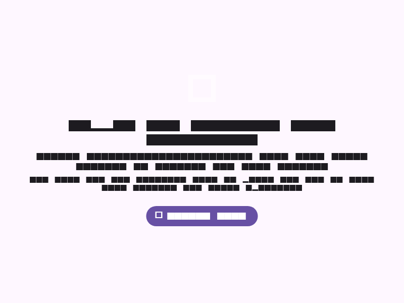

# FNAF Flutter

A faithful port of **Five Nights at Freddy's** to Flutter, for desktop, mobile and web.

Bring your own copy: on first run the app asks for the original `FiveNightsatFreddys.exe` and extracts everything it needs locally — nothing is uploaded anywhere.




## Download

Grab the latest release for your platform:

- **Android** — APK / AAB
- **Linux** — AppImage-style tarball, `.deb`, `.rpm`, zip, and a signed Flatpak remote
- **Windows** — zip
- **macOS** — zip / dmg (arm64)
- **iOS** — unsigned `.ipa` for AltStore: `https://gitlab.com/HttpAnimations/fnaf-flutter/-/raw/main/repos/altstore.json`
- **Web** — play right in the browser at the landing page: <https://httpanimations.gitlab.io/fnaf-flutter/>

Releases: <https://gitlab.com/HttpAnimations/fnaf-flutter/-/releases>

### Flatpak (one-liner)

```
flatpak install https://httpanimations.gitlab.io/fnaf-flutter/fnaf.flatpakref
```

or the three-command version:

```
curl -fLO https://httpanimations.gitlab.io/fnaf-flutter/flatpak/key.gpg
flatpak remote-add --if-not-exists --gpg-import=key.gpg fnaf https://httpanimations.gitlab.io/fnaf-flutter/flatpak
flatpak install fnaf gitlab.httpanimations.fnafflutter
```

## Features

- All five nights plus the 6th night and custom night
- The full camera system, doors, lights and power management
- Bonnie, Chica, Freddy and Foxy AI tuned like the original
- Phone calls, jumpscares, ambient audio straight from the game
- Saves your progress automatically
- English, 简体中文, Русский and Gaeilge

## Legal

You must own Five Nights at Freddy's to play. This project contains no copyrighted assets — they're read from your own game files at runtime.
